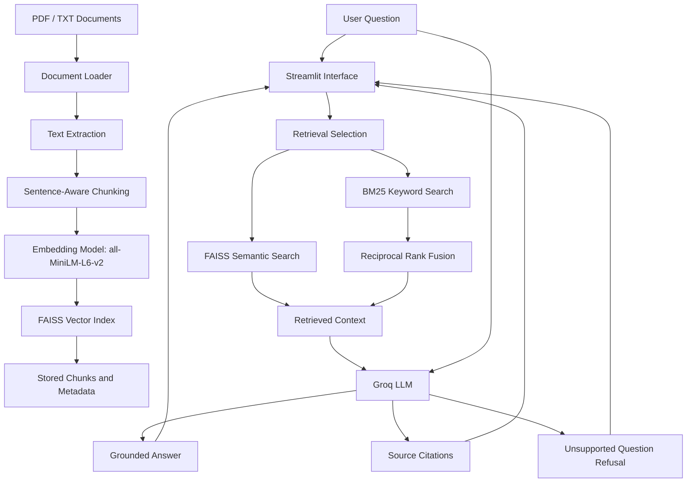

# RAG Chatbot Architecture

## System Workflow

## Main Components

- **Document ingestion:** Extracts text from PDF and TXT files.
- **Chunking:** Splits extracted text into manageable, overlapping chunks.
- **Embeddings:** Converts document chunks and user questions into 384-dimensional vectors.
- **Vector database:** FAISS IndexFlatIP stores and searches normalized embeddings.
- **Hybrid retrieval:** Combines BM25 keyword retrieval and FAISS semantic retrieval using Reciprocal Rank Fusion.
- **LLM:** Groq generates responses using retrieved document context.
- **Interface:** Streamlit provides document upload, index management, retrieval selection, chat history and source display.

## Answer Grounding

The LLM receives the user question and retrieved context. It is instructed to answer using the supplied context, cite sources and refuse questions when sufficient supporting information is unavailable.
